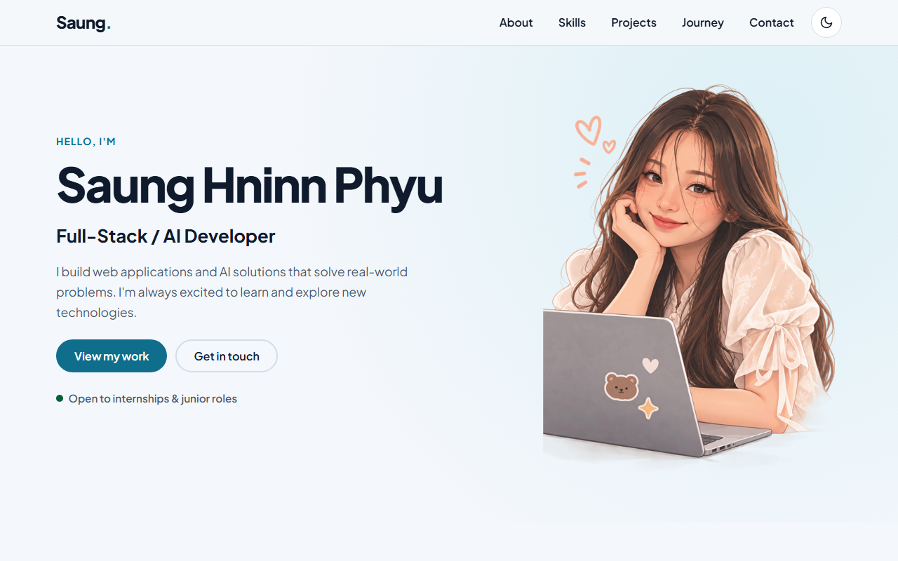
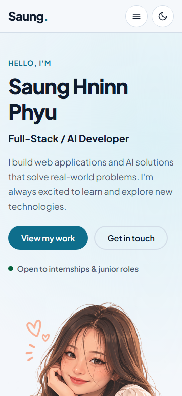

# Saung Hninn Phyu – Portfolio

A one-page personal portfolio built with plain **HTML, CSS and vanilla JavaScript**: no frameworks, libraries, build step or backend. It introduces me, lists the skills I'm using and learning, shows my projects with category filters, and gives visitors ways to get in touch.

Built for the Let's Tech Club Fullstack Development portfolio project.

| Desktop (1280px) | Mobile (360px) |
| --- | --- |
|  |  |

## How to run it

No installation is needed.

- **Quickest:** open `index.html` in a browser.
- **Recommended** (so the saved theme persists on the same address): serve the folder locally, then open <http://localhost:5500>.

  ```bash
  python -m http.server 5500
  ```

  The VS Code **Live Server** extension also works.

## Project structure

| Path | Purpose |
| --- | --- |
| `index.html` | Page content and semantic structure |
| `css/style.css` | All styles, light/dark theme tokens and responsive rules |
| `js/theme-init.js` | Tiny script in `<head>` that applies the saved theme before the page paints (prevents a light flash on reload) |
| `js/main.js` | Project data, card rendering, filtering, mobile menu, theme toggle and form validation |
| `assets/` | Images, logos, certificate images and my CV |
| `screenshots/` | Desktop and mobile screenshots for submission |

## Features

### Page sections
Header with navigation · Hero · About · Skills (with "Learning" badges) · Projects · Journey (education and certificates) · Contact form, email and profile links · Footer.

### 1. Mobile navigation
- Below 860px a real `<button>` opens and closes the menu; `aria-expanded` always matches its state.
- Choosing a link scrolls to that section and closes the menu. Escape or clicking outside also closes it.
- Closed links use `display: none`, so they are out of the keyboard tab order.
- If JavaScript is off, the links simply stay visible.

### 2. Contact form validation
- Name of at least 2 characters, a valid email format, and a message of 20 to 500 characters, all checked **after trimming spaces**.
- Each invalid field shows an error beside it (icon + text + red border, so it isn't colour alone) and `aria-invalid`. Focus moves to the first invalid field.
- Errors clear as soon as a field becomes valid, entered values are kept, and a live counter shows message length.
- A valid form does **not** send anything. It shows the status message "Demo only. Your message has not been sent." without reloading. The email link is the real way to contact me.

### 3. Project cards and category filters
- Projects are stored in the `projects` array of objects in `js/main.js` (title, description, category, technologies, demo and/or source URL).
- Cards **and** filter buttons are generated from that data, so adding a project, or even a new category, needs no HTML changes.
- Filters: **All (7)**, **Web Apps (3)**, **AI Apps (2)**, **Machine Learning (2)**. The selected button uses `aria-pressed="true"`, a filled style and a check mark, and the visible result count is announced.
- Filtering uses `Array.filter()` (a new array) and `replaceChildren()`, so the original data is never changed and switching filters never duplicates cards.

### 4. Light and dark theme
- The moon/sun button is named "Dark theme" and uses `aria-pressed` for its state.
- Both themes are built from CSS custom properties, so the whole page (cards, nav, form fields, buttons and messages) changes together.
- The choice is saved in `localStorage` and restored on reload; light is the default.
- All storage access is wrapped in `try/catch`, so if storage is blocked the toggle still works for the current visit.

### Accessibility
Semantic landmarks (`header`, `nav`, `main`, `section`, `footer`), one `h1` with a logical heading order, a skip link, visible labels, descriptive alt text (decorative logos use `alt=""`), a high-contrast focus ring in both themes, links that say when they open in a new tab, and reduced-motion support.

## Testing done

| Test | Result |
| --- | --- |
| Widths of 360, 768 and 1280px | No horizontal overflow; cards stack to 1, 2 or 3 columns |
| Navigation | All section links work; mobile menu opens, closes, and closes after choosing a link |
| Keyboard | Tab order: skip link, logo, menu, links (only when open), theme toggle, then page content; Enter opens the menu |
| Invalid form | Empty, 1-character name, `bad@x` email, 9-character and 501-character messages are rejected with focus on the first invalid field |
| Valid form | Shows the demo-only message, no reload, values kept |
| Filters | All 7 → Web Apps 3 → AI Apps 2 → Machine Learning 2 → All 7, with repeated switching and no duplicates |
| Theme | Dark persists after reload; light persists after reload; works with storage blocked |
| Links and console | All 18 external links return 200; no console errors |

**Project data test:** add a temporary object to the `projects` array in `js/main.js` and reload. A new card appears, and its category's count updates. Remove it afterwards.

## Known limitations

- The contact form is a frontend demo only and never sends messages.
- Project screenshots are static images captured from each live demo, so they may not match the latest version of those sites.
- Two machine-learning projects have no live demo, so they link to their source code only.
- Fonts come from Google Fonts; offline, the page falls back to the system font.

## Credits

- All text, project content, the hero illustration, CV and certificate images are my own, reused from my previous portfolio.
- University logos belong to the University of Wollongong and the Singapore Institute of Management, and are used only to identify my education.
- Font: [Plus Jakarta Sans](https://fonts.google.com/specimen/Plus+Jakarta+Sans) (SIL Open Font License) via Google Fonts.
- Icons are simple inline SVGs drawn for this site.
- Project screenshots were captured once with [Microlink](https://microlink.io/) and saved locally.
